# Exploratory case study: *Danio rerio* (PRJNA1005695)

This example demonstrates the portability of MTD Explorer to an independent host species and a contrast-free analysis design. Its purpose is to show how the software builds or uses host resources, processes paired-end RNA-seq, separates host and non-host reads, and produces descriptive taxonomic, functional and host-expression outputs. It is not a biological reanalysis of the source study, a diagnostic exercise, or an assessment of taxonomic classification accuracy.

See the [example datasets overview](example-datasets.md) and the [comparative case study](example-dataset.md) for the complementary analysis design.

## Dataset and sample selection

| Attribute | Value |
|---|---|
| Host | *Danio rerio* (zebrafish), NCBI TaxID `7955` |
| BioProject | [PRJNA1005695](https://www.ncbi.nlm.nih.gov/bioproject/PRJNA1005695) |
| Original study | Rice et al. (2024), [PLOS Biology 22:e3002606](https://doi.org/10.1371/journal.pbio.3002606) |
| Tissue | Adult intestine |
| Libraries | Six selected paired-end runs |
| Platform | Illumina NovaSeq 6000 |
| Deposited read length | 2 × 151 bases, as calculated from ENA base and read counts |
| Raw input | 211,733,551 read pairs; 63,943,532,402 bases |
| Compressed FASTQs | 12 files; 23,213,097,170 bytes (~21.62 GiB) |
| Analytical group | `Zebrafish` |
| Analysis mode | `exploratory` |

The deposited project contains 27 runs. For this software demonstration, the first two numbered intestinal replicates from each of the three pet-trade sources were selected, retaining the original run accessions. Source and sex metadata are recorded for traceability but are not used to define analytical contrasts. No reads were subsampled. The selected dataset does not include negative controls.

| Replicate | Run accession | BioSample | Source | Sex | Read pairs |
|---|---|---|---|---|---:|
| P1 | [SRR25649182](https://www.ncbi.nlm.nih.gov/sra/SRR25649182) | SAMN36996027 | pet trade 1 | male | 38,868,142 |
| P2 | [SRR25649181](https://www.ncbi.nlm.nih.gov/sra/SRR25649181) | SAMN36996028 | pet trade 1 | male | 35,622,965 |
| E1 | [SRR25649162](https://www.ncbi.nlm.nih.gov/sra/SRR25649162) | SAMN36996030 | pet trade 2 | female | 31,619,421 |
| E2 | [SRR25649161](https://www.ncbi.nlm.nih.gov/sra/SRR25649161) | SAMN36996031 | pet trade 2 | female | 36,282,065 |
| T1 | [SRR25649159](https://www.ncbi.nlm.nih.gov/sra/SRR25649159) | SAMN36996033 | pet trade 3 | female | 33,176,365 |
| T2 | [SRR25649158](https://www.ncbi.nlm.nih.gov/sra/SRR25649158) | SAMN36996034 | pet trade 3 | male | 36,164,593 |

The original publication is cited for dataset provenance. The selected subset is not intended to reproduce its biological comparisons.

## Reproduce the input preparation

Download the paired FASTQs using the URLs in the [selected ENA metadata](../assets/data/example-dataset/danio-rerio/ena-selected-runs.tsv), and keep both files for every accession. The following example downloads the files from that table using Python's standard library; it skips existing files only when the expected file size matches. Verify every MD5 checksum after download before starting the workflow.

```bash
BASE="$HOME/MTD-Explorer_Exploratory_D.rerio"
mkdir -p "$BASE/raw_fastq"
# Save ena-selected-runs.tsv, FASTQ_expected.md5 and samplesheet.csv
# from the links on this page into $BASE first.
python3 - "$BASE" <<'PYCODE'
import csv, pathlib, sys, urllib.request
base = pathlib.Path(sys.argv[1])
with (base / 'ena-selected-runs.tsv').open() as f:
    for row in csv.DictReader(f, delimiter='\t'):
        for url, size in zip(row['fastq_ftp'].split(';'), row['fastq_bytes'].split(';')):
            target = base / 'raw_fastq' / url.rsplit('/', 1)[-1]
            if not target.is_file() or target.stat().st_size != int(size):
                tmp = target.with_suffix(target.suffix + '.part')
                urllib.request.urlretrieve('https://' + url, tmp)
                if tmp.stat().st_size != int(size):
                    raise RuntimeError(f'Unexpected file size: {tmp}')
                tmp.replace(target)
PYCODE
(cd "$BASE" && md5sum -c FASTQ_expected.md5)
cp "$BASE/samplesheet.csv" "$BASE/raw_fastq/samplesheet.csv"
```

The archived run used ENA FASTQs downloaded with aria2c; the download command above is an equivalent way to retrieve the same files. All 12 original FASTQ checksums passed before the analysis. The [MD5 manifest](../assets/data/example-dataset/danio-rerio/FASTQ_expected.md5) and [samplesheet](../assets/data/example-dataset/danio-rerio/samplesheet.csv) are provided separately.

## Prepare host and microbial references

The host is present in the MTD Explorer host catalog. The automated custom-host builder was used, without species-specific changes to the analysis source:

```bash
cd "$HOME/MTD-Explorer"
bash Create_custom_host.sh --ncbi-taxon-id 7955
```

| Reference component | Recorded configuration |
|---|---|
| Host assembly | GRCz11 |
| Reference release | Ensembl 116 |
| Host Kraken2 | TaxID 7955 |
| Host alignment | HISAT2 index |
| Host GTF | 32,520 annotated genes |
| Custom annotation | `org.Drerio.eg.db` 1.0.0, eggNOG-mapper 2.1.3 / eggNOG database 5.0.2 |
| Genes with eggNOG GO annotation | 18,517 |
| GO terms in master GMT | 23,680 (before downstream filtering) |
| Host KEGG organism | `dre` |

The custom OrgDb was built and validated as an alternative to the standard host annotation package. This case demonstrates reference construction, not the completeness of any particular annotation resource. The [host catalog entry](../assets/data/example-dataset/danio-rerio/host-catalog-entry.csv) records the genome, GTF and protein URLs. See [Custom host references](custom-host-references.md).

The existing microbial Kraken2 database used k = 35 and minimizer length 31. A 150-base Bracken distribution was added to the existing database; the original 75-base distribution was retained. Use the database's actual k-mer length, not an assumed default.

```bash
DB="$HOME/MTD-Explorer/kraken2DB_micro"
conda activate MTD_kraken2
kraken2-inspect --db "$DB" --skip-counts
bracken-build -d "$DB" -t 20 -k 35 -l 150
ls -lh "$DB/database150mers.kmer_distrib"
```

The 150-base distribution is an explicit analytical setting (the deposited FASTQs contain 151-base mates); it is not a claim that all post-trimming reads are exactly 150 bases. Database and distribution construction costs are reported separately from the analytical runtime. Use an existing validated distribution if available.

!!! note "Contaminant-filter setting"

    For this demonstration the optional local `conta_ls.txt` list was moved outside the checkout before the run, preserving its checksum and keeping host filtering enabled. No blanket contaminant removal was performed. This setting is specific to this case and is not a general recommendation. Negative controls were not included in the selected data; contamination cannot be ruled out. To reproduce this setting at the recorded commit, archive the list outside the checkout before launching the analysis and restore it after the run, if needed. Do not commit the local deletion.

## Samplesheet and command

All samples belong to a single analytical group; comparison columns remain empty.

```csv
sample_name,group,comparisons,group1,vs,group2
SRR25649182,Zebrafish,,,,
SRR25649181,Zebrafish,,,,
SRR25649162,Zebrafish,,,,
SRR25649161,Zebrafish,,,,
SRR25649159,Zebrafish,,,,
SRR25649158,Zebrafish,,,,
```

The definitive run used [commit `5be26aa`](https://github.com/patrick-douglas/MTD-Explorer/commit/5be26aa2e03938abb12fe00a37a08b0c0cef3777), dated 25 November 2026. A fresh result directory was used. Prepare the matching installation and references before running the command; the existing databases were reused.

```bash
BASE="$HOME/MTD-Explorer_Exploratory_D.rerio"
REPO="$HOME/MTD-Explorer"
conda activate MTD
cd "$REPO"
mkdir -p "$BASE/logs" "$BASE/provenance" "$BASE/results"
export R_LIBS_USER="$REPO/custom_R_libs:${R_LIBS_USER:-}"
export MTD_PIPELINE_BENCHMARK_STEPS_TSV="$BASE/provenance/pipeline_stage_timing.tsv"
set -o pipefail
/usr/bin/time -v bash MTD_explorer.sh \
  --input "$BASE/raw_fastq/samplesheet.csv" \
  --output "$BASE/results/Danio_rerio_exploratory" \
  --hostid 7955 \
  --analysis-mode exploratory \
  --read-layout pe \
  --threads 20 \
  --trim-length 40 \
  --bracken-read-len 150 \
  --bracken-threshold 10 \
  --kraken-host-confidence 0.05 \
  --kraken-host-min-hit-groups 3 \
  --kraken-micro-confidence 0.10 \
  --kraken-micro-min-hit-groups 3 \
  --ssgsea-gmt auto \
  --resume-heavy \
  2>&1 | tee "$BASE/logs/MTD_Danio_rerio_exploratory.log"
```

Although `--resume-heavy` was enabled, the result directory was absent at launch and no previous checkpoints were reused. This is a fresh-directory execution, not an assertion of an operating-system cold cache. With no contrasts, differential expression, comparison-specific enrichment, ssGSEA and HAllA were skipped as expected for this run. The requested `--ssgsea-gmt auto` setting does not mean that ssGSEA was executed.

## Read preparation and host/non-host separation

The run retained 211,162,852 of 211,733,551 read pairs (99.73%). The following classification summary uses the retained pairs as its denominator.

| Classification | Read pairs | Share |
|---|---:|---:|
| Host | 205,837,716 | 97.478% |
| Microbiome-classified | 540,933 | 0.256% |
| Unclassified | 4,784,203 | 2.266% |
| Total | 211,162,852 | 100% |

These are pipeline classification categories, not measurements of biomass, cell abundance or infection status. The read-composition workflow provides both a global flow and sample-level summaries.

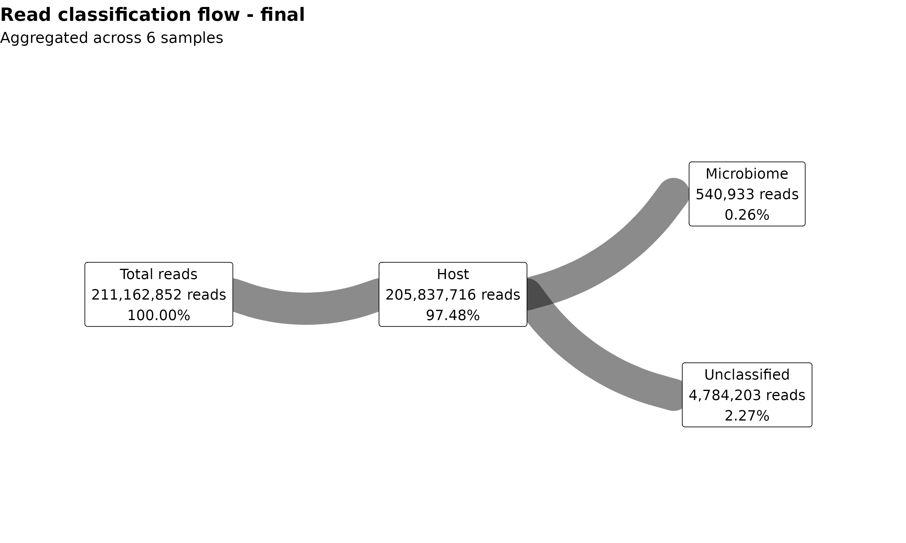

*Native read-composition flow for the six-library run.* [PDF](../assets/images/example-dataset/danio-rerio/read-composition-flow.pdf).

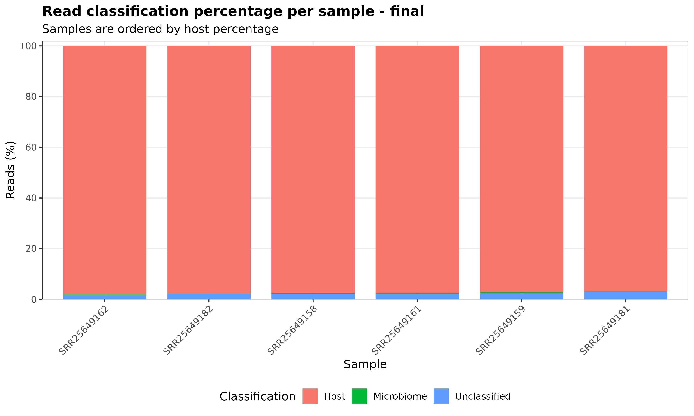

*Sample-level classification percentages from the final Kraken2 summary.* [PDF](../assets/images/example-dataset/danio-rerio/read-composition-barplot.pdf).

## Taxonomic profiling and visualizations

Bracken produced matrices for 104 species-level, 94 genus-level and 22 phylum-level assignments. The species matrix contains 478,140 estimated fragments across six libraries. The native outputs demonstrate matrix generation, stacked composition plots, a BIOM export, Krona and GraPhlAn. Species-level outputs are shown here because `species` was the default exploratory rank; the genus and phylum matrices remain available.

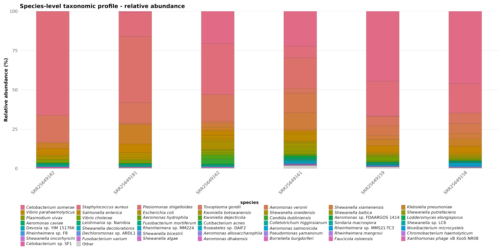

*Native top-50 species relative-abundance plot; values are composition within the classified species-level matrix.* [PDF](../assets/images/example-dataset/danio-rerio/species-relative-abundance.pdf).

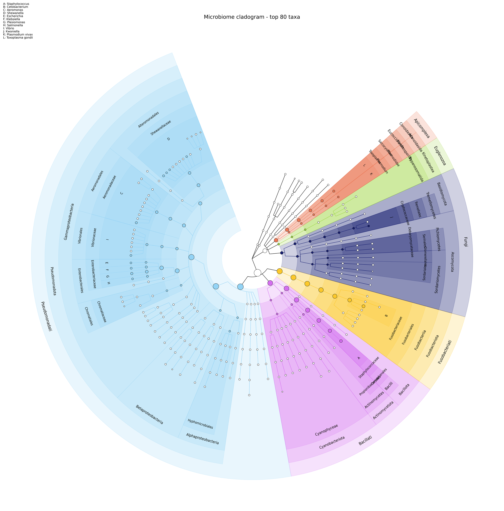

*Native GraPhlAn cladogram from the definitive run (resized PNG preview for web display).* [Original PNG](../assets/images/example-dataset/danio-rerio/graphlan-species.png) · [PDF](../assets/images/example-dataset/danio-rerio/graphlan-species.pdf).

See [Taxonomic visualizations](taxonomic-visualizations.md) for the Krona and GraPhlAn workflow.

## Taxon Prioritization Index (TPI)

The TPI ranks computationally detected taxa by prevalence and abundance. The default weights are prevalence 0.45, mean abundance 0.30, maximum abundance 0.15 and total abundance 0.10. Abundance components are transformed and normalized as documented in [Taxonomic exploratory outputs](taxonomic-exploratory-outputs.md). Both absolute and relative modes were generated natively.

The three-panel overview shows (A) the ranked taxa, (B) the weighted component contributions and (C) the prevalence–abundance landscape. The relative mode uses per-library composition; the absolute mode uses estimated Bracken counts. Neither mode establishes the biological identity of an assigned taxon.

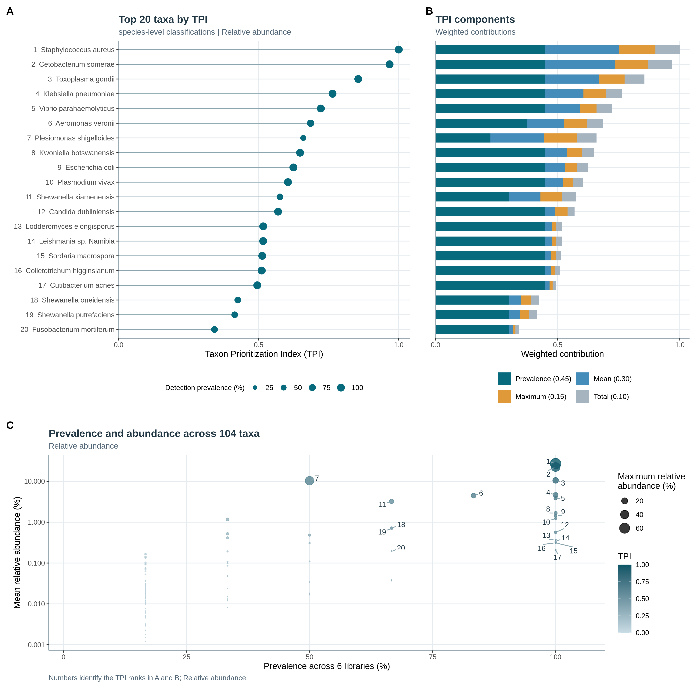

*Native integrated TPI using relative abundance.* [PDF](../assets/images/example-dataset/danio-rerio/tpi-relative.pdf).

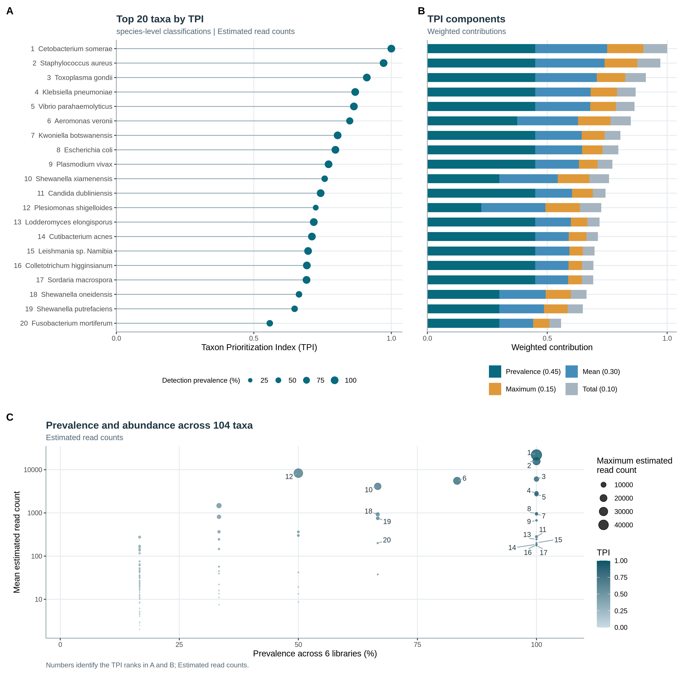

*Native integrated TPI using estimated read counts.* [PDF](../assets/images/example-dataset/danio-rerio/tpi-absolute.pdf).

The 104-taxon rankings were identical between the pre-correction and definitive analytical executions. Independent recalculation of the score from the final matrix agreed within 5 × 10⁻⁷ (six-decimal output rounding). The two modes need not produce the same ordering and their scores are dataset-dependent.

!!! warning "Interpret classifications as computational outputs"

    Recurrent or high-abundance assignments can be inaccurate, particularly with conserved sequences, residual host material, incomplete reference coverage or contamination. Some labels in these native figures are biologically unexpected. They are preserved to document the software's actual output, not presented as confirmed organisms, infections or evidence of microbial activity. The TPI is a descriptive ranking, not an identity validator or statistical significance test. No biological inference about the source populations is made here.

## Core microbiome and diversity outputs

The species-level core output contains 15 assignments at prevalence ≥75% (at least five of six libraries) and 14 at 100% (six of six libraries). These operational thresholds illustrate the prevalence filter; the labels are not a validated biological core community.

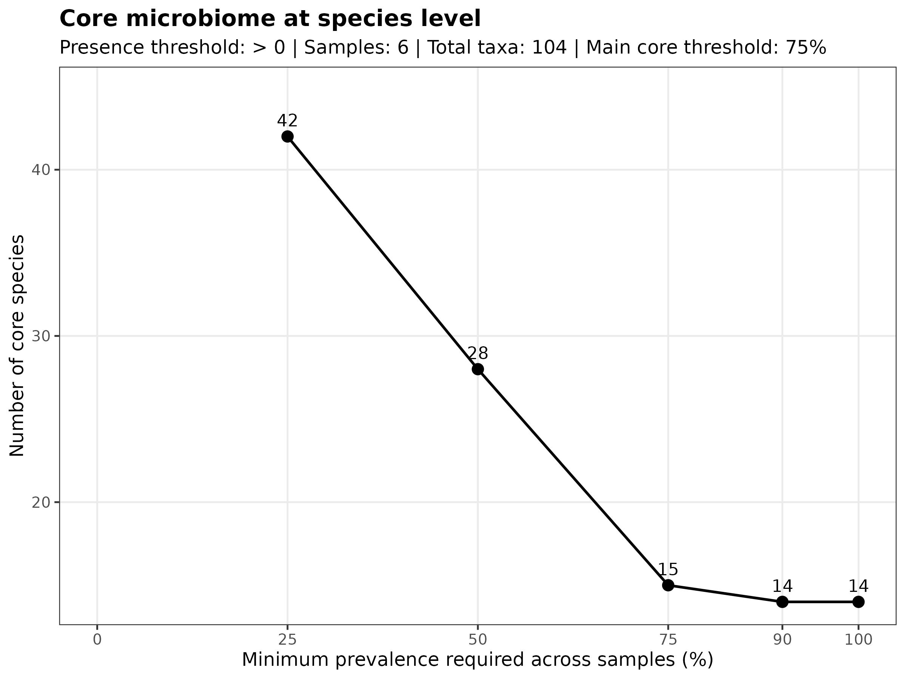

*Native core-prevalence output for the six samples.* [PDF](../assets/images/example-dataset/danio-rerio/core-microbiome.pdf).

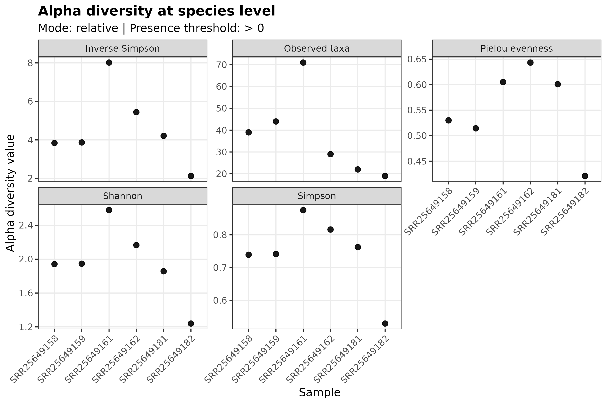

*Observed richness and descriptive diversity indices by library.* [PDF](../assets/images/example-dataset/danio-rerio/alpha-diversity.pdf).

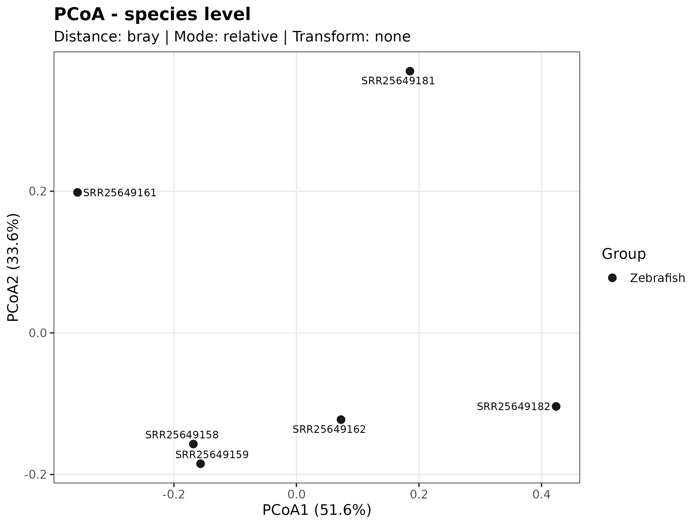

*Native PCoA illustrating sample dissimilarity without a group-level hypothesis test.* [PDF](../assets/images/example-dataset/danio-rerio/beta-diversity-pcoa.pdf).

Observed richness depends on classification depth. The ordination is descriptive and no PERMANOVA was performed with the single analytical group. See [Taxonomic exploratory outputs](taxonomic-exploratory-outputs.md).

## Microbiome matrix QC

The matrix QC module summarizes the normalized abundance matrix, feature detection, sample correlations, PCA and variable-feature heatmaps. The corrected implementation maps the Bracken column identifiers to the six samplesheet IDs, retaining the `Zebrafish` group in the native plots.

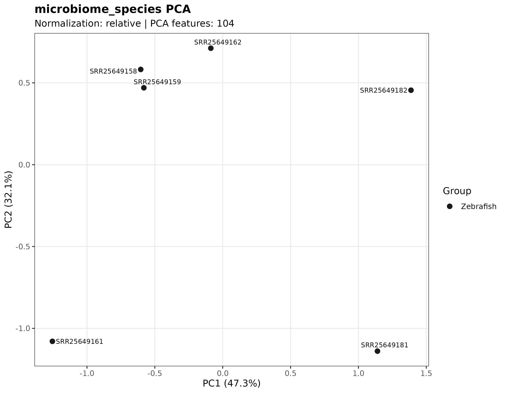

*Native microbiome PCA using the corrected sample identifiers and group metadata.* [PDF](../assets/images/example-dataset/danio-rerio/microbiome-pca.pdf).

## Host expression outputs

HISAT2 and featureCounts (paired-fragment counting) were executed in all six libraries. The GTF contained 32,520 genes; 28,956 genes were detected in at least one library and retained for exploratory expression summaries. Host expression QC produced PCA, sample correlations and a variable-feature heatmap, without differential-expression testing.

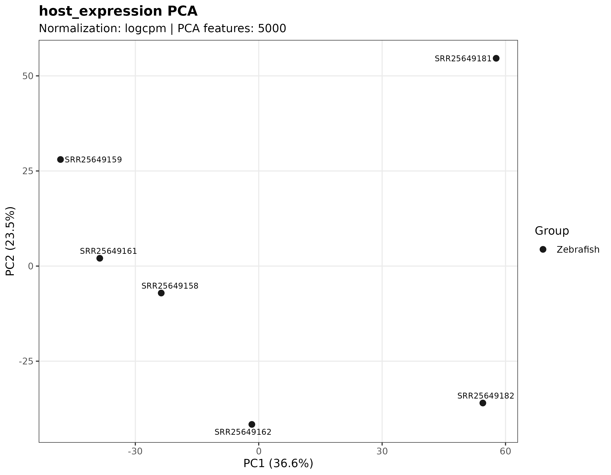

*Native exploratory host-expression PCA.* [PDF](../assets/images/example-dataset/danio-rerio/host-expression-pca.pdf).

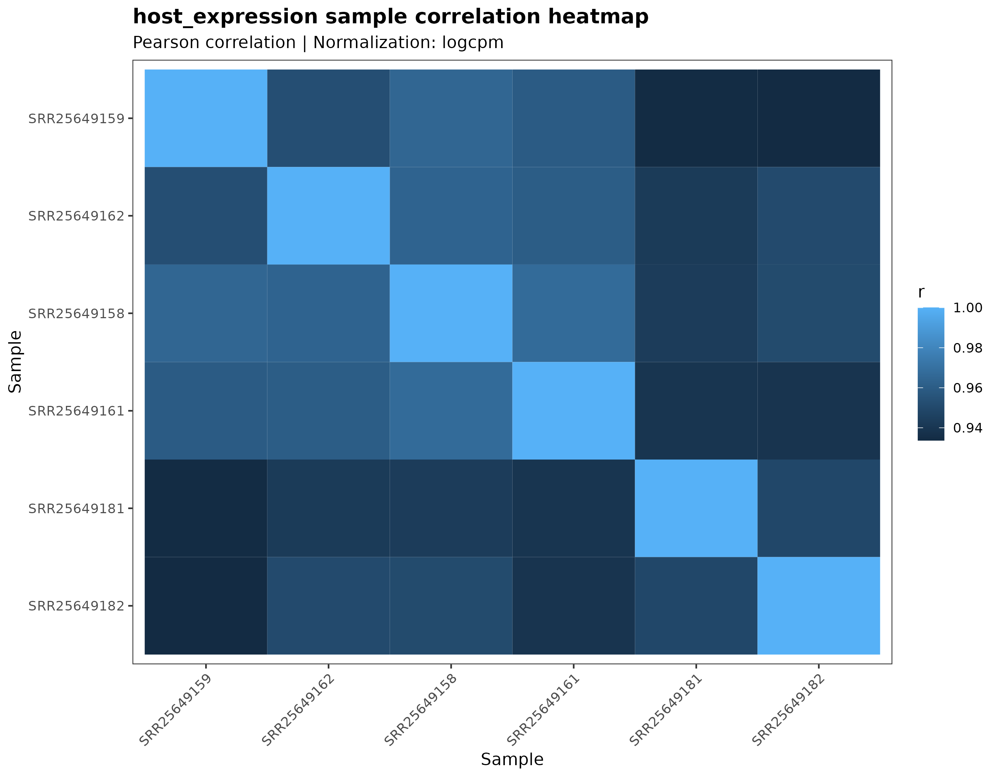

*Native sample-correlation heatmap.* [PDF](../assets/images/example-dataset/danio-rerio/host-expression-correlation.pdf).

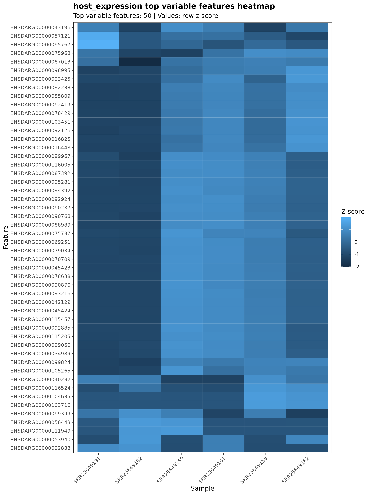

*Native heatmap of selected variable expression features.* [PDF](../assets/images/example-dataset/danio-rerio/host-expression-variable-features.pdf).

See [Host expression outputs](host-expression-outputs.md).

## Microbial functional profiling

HUMAnN produced gene-family profiles and GO/KEGG regrouped tables. The numbers below describe output coverage, not functional enrichment or validated pathway activity.

| Output | Number |
|---|---:|
| Unique UniRef90 gene families (unstratified; excluding UNMAPPED) | 8,834 |
| Unique GO identifiers | 2,127 |
| Unique KO identifiers | 458 |
| MetaCyc pathways (excluding special categories) | 16 |
| GO translated table rows | 2,700 |
| KEGG translated table rows | 580 |
| Functional ID mapping tables | 4 |

GO/KEGG tables preserve original identifiers, including special `UNGROUPED` categories, and provide ID maps for traceability. Three non-functional rows per annotation table are marked ineligible for functional differential analysis; no differential analysis was requested in this example. The full profiles are retained.

Three libraries (`SRR25649162`, `SRR25649181`, `SRR25649182`) had zero reconstructed pathway abundance after normalization, despite gene-family profiles being recovered. This is a coverage limitation of the input/reference/profiling combination rather than evidence of biological absence. See [Functional profiling outputs](functional-profiling-outputs.md).

## Computational performance

The definitive execution completed with exit status 0 and 678 output files; no empty files were recorded. Measurement used GNU `/usr/bin/time -v` and pipeline stage markers, not the instrumented official-clean benchmark wrapper. Reference construction was measured independently.

| Metric | Observed value |
|---|---:|
| Wall time | 4 h 12 min 53 s (15,173 s) |
| Maximum reported RSS | 113,107,988 KiB (~107.87 GiB) |
| CPU utilization reported by GNU time | 1089% |
| Configured threads | 20 |
| Swaps reported by GNU time | 0 |
| Final output footprint (`du -h`) | ~459 GiB |
| Host reference construction | 1 h 30 min 05 s |
| Bracken distribution construction | 49 min 05 s |

Most of the output footprint consists of intermediate reads and alignment files. Maximum RSS reported by GNU time is not a sampled peak aggregate process-tree measurement. These values are workload-specific. See [Pipeline benchmarking](benchmarking.md#reference-exploratory-run-prjna1005695) for timing intervals and the comparison limitations.

## Reproducibility and regression checks

The definitive run was repeated from a fresh output directory after corrections to sample metadata matching, fastp runtime provenance and functional ID translation. The pre-correction and final runs reproduced all three Bracken matrices and both TPI rankings byte-for-byte. In the host count matrix, 195,115 of 195,120 count cells matched exactly; the five differences were at most two counts. The detected gene set was preserved. This supports computational repeatability for this particular workload, not a universal guarantee of bitwise determinism. The full comparative DEG and Slurm regressions are separate validation tasks.

Selected runtime versions reported by this execution include fastp 1.3.6 (all six JSON reports), Kraken2 2.17.1, Bracken Conda package 3.1p1 (CLI banner 3.0.1), HUMAnN 3.9, MetaPhlAn 4.1.1, HISAT2 2.2.1 and featureCounts 2.1.1. The two Bracken version fields are retained because they describe different sources of version information. Generic best-effort software version fields should not be treated as proof of an individual tool's runtime environment.

### Downloadable materials

- [Selected ENA run metadata](../assets/data/example-dataset/danio-rerio/ena-selected-runs.tsv) and [BioSample attributes](../assets/data/example-dataset/danio-rerio/biosample-attributes.tsv)
- [Samplesheet](../assets/data/example-dataset/danio-rerio/samplesheet.csv) and [FASTQ MD5 checksums](../assets/data/example-dataset/danio-rerio/FASTQ_expected.md5)
- [Host catalog entry](../assets/data/example-dataset/danio-rerio/host-catalog-entry.csv)
- [Run parameters](../assets/data/example-dataset/danio-rerio/run-parameters.csv) and [fastp runtime provenance](../assets/data/example-dataset/danio-rerio/fastp-runtime.tsv) (local home-directory prefixes normalized to `$HOME/`)
- [Stage timing TSV](../assets/data/example-dataset/danio-rerio/pipeline-stage-timing.tsv)
- [Figure source map and checksums](../assets/data/example-dataset/danio-rerio/figure-source-map.tsv)
- [Source tables archive](../assets/data/example-dataset/danio-rerio/source-tables.zip): selected scientific matrices and provenance, with SHA-256 checksums. This is not a full raw-data, log or database snapshot.

The downloaded figures and scientific tables come from the definitive run, not the pilot or isolated patch tests. Reference database contents and software environments can change over time; consult the recorded settings when reproducing the example. The case illustrates software execution and output generation, not independent validation of taxonomic or biological claims.
